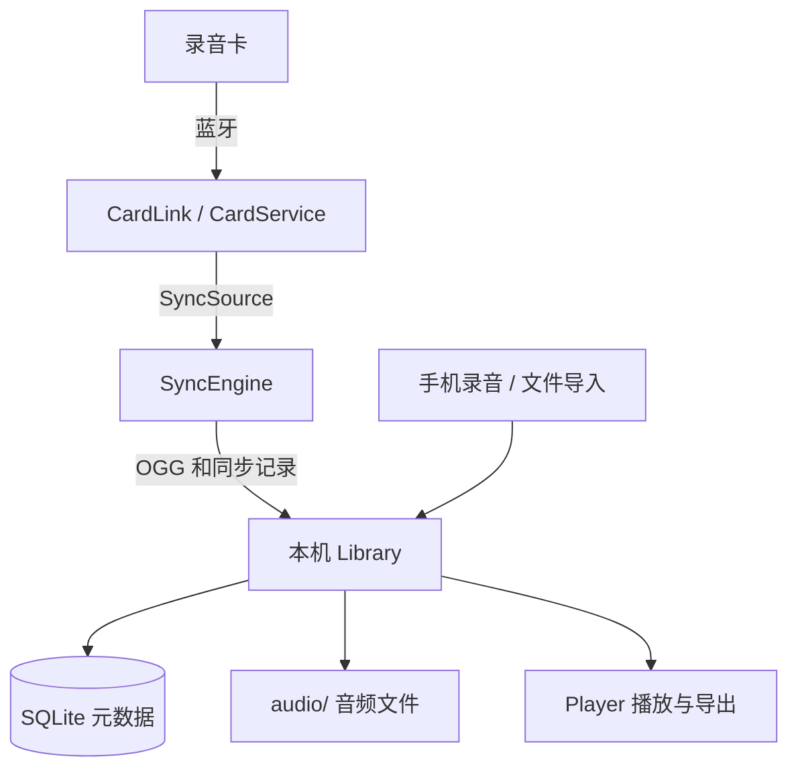
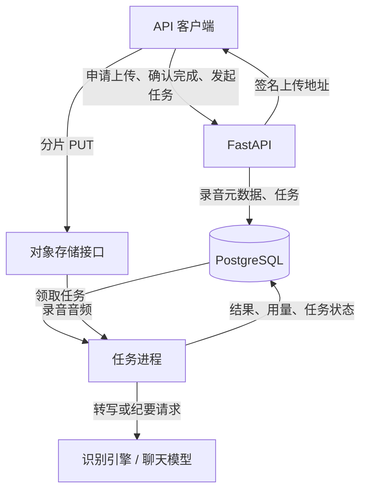

# 闻笺架构与本地开发

本文按 2026-11-26 检查的主干 `2a638e8` 描述可运行的代码。iPhone、Mac 和后端各有自己的存储。要改一项功能，先确定它在哪一端发起，以及谁负责持久化结果。

## 从哪个入口读代码

| 我要改什么 | 先看这里 | 运行时行为 |
|---|---|---|
| iPhone 上的配对、录音、同步 | [AppEnvironment](../app/Revive/AppEnvironment.swift)、[CardSession](../app/ReviveKit/Sources/AppModel/CardSession.swift) | SwiftUI 的页面模型共用一个卡会话。初次选「先不连卡」可先用本地录音库和手机麦克风，之后再请求蓝牙权限。 |
| Mac 上的录音整理 | [MacEnvironment](../app/ReviveMac/MacEnvironment.swift)、[LibraryWindow](../app/ReviveMac/LibraryWindow.swift) | Mac 打开自己的录音库，共用 ReviveKit 的播放、导入、转写和纪要能力。当前界面从本机文件导入，卡配对与同步仍待接入。 |
| 助手读写 Mac 录音库 | [revive 入口](../app/ReviveKit/Sources/revive/main.swift)、[LibraryTools](../app/ReviveKit/Sources/LibraryTools/) | CLI 与 MCP stdio 共享一套工具。Mac App 首次启动会创建录音库，随后 CLI 可查询或新增记录。`revive mcp --read-only` 只暴露查询工具。 |
| 账号、上传、云端任务 | [API 入口](../backend/revive_api/main.py)、[任务进程](../backend/revive_api/worker.py) | FastAPI 接收 HTTP 请求。后台进程领取 PostgreSQL 中的任务并写回结果。 |
| 卡协议对照、实验复现 | [Python 客户端](../client/dnote.py)、[iOS 原型](../ios-prototype/) | Python 可以独立连接卡，也用于生成跨语言协议测试样本。阶段 0 快传实验与正式 App 的蓝牙同步各有入口。 |

## 一段卡录音如何进入本地库

图中箭头表示录音和本地数据的去向。Swift 包的实际编译依赖以 [Package.swift](../app/ReviveKit/Package.swift) 为准。



1. `CardSession` 把连接和录音停止事件转给 `SyncEngine`。`CardProtocol` 处理帧和音频格式，`CardSyncSource` 把设备操作适配成 `DeviceSource` 模块里的 `SyncSource`。替换设备协议时，先从这个接口入手。
2. 同步引擎检查连接、配对和录音状态，按设备、文件名及大小识别已有条目。下载途中写入临时分片。同一进程内断连后可以按已有长度续传，App 重新启动时清理临时文件，重新下载未提交的录音。
3. 引擎核对下载长度，调用设备适配器解密并封装 OGG，将音频暂存、刷盘并移入 `audio/`，最后在一个数据库事务中写入录音及同步状态。事务失败会尝试移除音频，启动恢复负责清理孤立文件。
4. 默认保留卡端文件。用户开启同步后删除或要求丢弃该条录音时，引擎在删除前再次确认本地副本存在，之后重新列卡端清单确认结果。故障注入覆盖了下载中断、提交前后失败和删除确认等边界。[同步实现](../app/ReviveKit/Sources/SyncEngine/SyncEngine.swift) · [回归测试](../app/ReviveKit/Tests/SyncEngineTests/)

## 哪些功能会发出请求

| 用户选择 | 处理的数据与去向 | 入口 |
|---|---|---|
| 本机转写 | 音频由 Apple 设备上的 Speech 识别，需语音识别权限与可用语言。本机开关开启时优先选择该路径。 | [引擎选择](../app/ReviveKit/Sources/AppModel/AISetup.swift) |
| 自配服务转写、生成纪要 | 配置转写模型后，云转写向该服务发送 M4A。纪要向配置的聊天模型发送文字稿或其分段提炼结果。API Key 存在系统钥匙串。 | [Assistant](../app/ReviveKit/Sources/Assistant/) |
| 导入播客链接 | iPhone 解析用户粘贴的 URL，按需访问网页、RSS 或 Apple 播客查询服务，再下载所选音频进入本机库。 | [LinkImport](../app/ReviveKit/Sources/LinkImport/) |
| 使用闻笺账号 | 构建的 `ReviveAPIBaseURL` 设为有效 HTTPS 地址才显示账号入口，当前默认值为空。Swift 账号客户端接入认证和个人账号接口，上传录音及轮询云端任务尚待 App 接入。 | [构建配置](../app/project.yml) · [AccountClient](../app/ReviveKit/Sources/Account/AccountClient.swift) |
| 助手查询录音库 | `revive` 通过本机标准输入输出返回结果。启动它的助手可以取得返回的文字，后续处理取决于该助手。 | [工具和隐私说明](assistant-tools.md) |

## 后端怎样处理一段录音

下图从调用后端 API 的客户端出发。可在开发环境单独验证这条流程。



本地默认使用 `LocalStore`、`LoggingSender`、`StandInTranscriber` 和 `StandInChatModel`。它们可验证传输、数据库事务和任务状态。生产模式在缺少真实依赖及额度配置时拒绝启动。接口路径、环境变量、迁移和两进程启动命令见[后端 README](../backend/README.md)，启动后可在服务的 `/docs` 浏览实际 OpenAPI 接口。

## 本地开发与验证

各段命令都从仓库根目录开始。Apple 平台使用 Xcode、Swift 6 和 XcodeGen，最低部署目标是 iOS 17、macOS 14。首次解析 Swift 包需能取得 GRDB。

```bash
scripts/check-m1-rules.sh && scripts/check-theme.sh
(cd app/ReviveKit && swift test --disable-xctest && swift build --product revive)
(cd app && xcodegen generate && xcodebuild build -project Revive.xcodeproj -scheme Revive \
    -destination 'generic/platform=iOS Simulator' CODE_SIGNING_ALLOWED=NO)
(cd app && xcodebuild build -project Revive.xcodeproj -scheme ReviveMac \
    -destination 'platform=macOS' CODE_SIGNING_ALLOWED=NO)
```

生成工程后，在 Xcode 打开 `app/Revive.xcodeproj`。选择 `Revive` 和 iOS 模拟器，点击运行并选「先不连卡」，即可走查无卡界面。选择 `ReviveMac` 和 My Mac 可运行桌面版。Linux 可用 [linux-test.sh](../app/ReviveKit/scripts/linux-test.sh) 跑支持的测试子集。

Python 客户端的离线测试会核对 Python 生成的字节样本与 Swift 包和 iOS 原型保存的样本。

```bash
python3 -m venv client/.venv
client/.venv/bin/python -m pip install -r client/requirements.txt pytest
(cd client && .venv/bin/python -m pytest)
```

后端需要 Python 3.12+ 和 PostgreSQL 16。测试会清空 `TEST_DATABASE_URL` 指定数据库的 `public` schema，请按[后端测试步骤](../backend/README.md#测试)准备专用测试库。三条 [CI 工作流](../.github/workflows/)分别检查 Apple 平台、客户端和后端。后台/锁屏的卡键事件、实卡吞吐、系统语音识别质量和 TestFlight 升级仍需按[真机清单](device-todo.md)留存证据。
